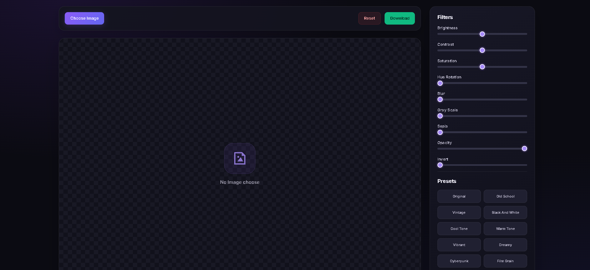
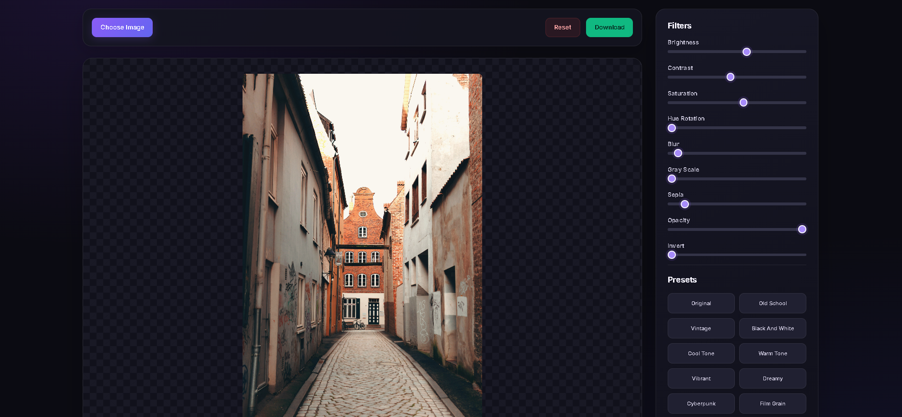

# 🎨 PixelCraft — Canvas 2D Image Editor

<p align="center">
  <b>A Browser-Based Image Editor Powered by the HTML5 Canvas 2D API</b>
</p>

<p align="center">
  Edit images in real time using canvas rendering, CSS filter effects, and creative presets — all directly in your browser.
</p>

<p align="center">
  
  
  
</p>

---

## 📌 About the Project

**PixelCraft** is a lightweight image editor built with HTML, CSS, and Vanilla JavaScript, with the **Canvas 2D API at its core**.

The application uses a canvas rendering context to draw uploaded images, apply visual filter effects, preview changes interactively, and export the edited result as a PNG image.

This project explores how the browser's canvas rendering capabilities can be used to build an interactive image-editing application without external image-processing libraries.

## ✨ Features

- 🖼️ Upload and render images on an HTML canvas
- 🎨 Apply real-time image filters using `CanvasRenderingContext2D.filter`
- ☀️ Adjust brightness and contrast
- 🌈 Control saturation and hue rotation
- 🌫️ Apply blur effects
- ⚫ Add grayscale and sepia effects
- 👻 Adjust opacity and invert colors
- 🎭 Apply predefined filter presets
- 🎚️ Update filters dynamically using range inputs
- ↩️ Reset all filter values
- 📥 Export edited canvas content as a PNG image
- ⚡ Interactive image preview without page reloads

## 🧠 Core Concept: Canvas 2D API

The Canvas 2D API provides methods and properties for drawing and manipulating graphics inside an HTML `<canvas>` element.

PixelCraft uses the following canvas features:

### 1. Getting the 2D Rendering Context

```javascript
const imageCanvas = document.querySelector("#imageCanvas");
const canvasCtx = imageCanvas.getContext("2d");
```

The `getContext("2d")` method returns a `CanvasRenderingContext2D` object that provides the drawing tools used by the editor.

### 2. Loading and Drawing Images

```javascript
const img = new Image();

img.onload = () => {
    imageCanvas.width = img.naturalWidth;
    imageCanvas.height = img.naturalHeight;

    canvasCtx.drawImage(img, 0, 0);
};
```

The image is loaded before being drawn. Setting the canvas dimensions to the image's natural dimensions preserves its original pixel dimensions in the exported canvas.

### 3. Applying Real-Time Filters

```javascript
canvasCtx.filter = `
    brightness(120%)
    contrast(110%)
    saturate(130%)
    blur(1px)
    grayscale(0%)
    sepia(10%)
    hue-rotate(20deg)
    opacity(100%)
    invert(0%)
`;

canvasCtx.drawImage(img, 0, 0);
```

The `filter` property applies supported visual effects to subsequent drawing operations. When the filter settings change, the image is drawn again to display the updated result.

### 4. Clearing the Canvas

```javascript
canvasCtx.clearRect(
    0,
    0,
    imageCanvas.width,
    imageCanvas.height
);
```

`clearRect()` clears the previous canvas content before the updated image is rendered. This prevents the previous drawing from remaining underneath the new rendering.

### 5. Exporting the Edited Image

```javascript
const imageURL = imageCanvas.toDataURL("image/png");

const downloadLink = document.createElement("a");
downloadLink.href = imageURL;
downloadLink.download = "edited-image.png";
downloadLink.click();
```

The `toDataURL()` method converts the canvas content into a PNG data URL, which can then be downloaded through a link.

## 📸 Project Preview

### Main Interface


### Filters and Presets


## 🔄 Image Rendering Workflow

1. The user uploads an image.
2. JavaScript loads the image into an `Image` object.
3. The canvas dimensions are set to match the image dimensions.
4. The 2D rendering context clears the previous drawing.
5. The selected filter values are assigned to `canvasCtx.filter`.
6. `drawImage()` renders the filtered image.
7. `toDataURL()` exports the final canvas content as a PNG.

## 🛠️ Tech Stack

- **HTML5 Canvas 2D API** — Image drawing and rendering
- **JavaScript** — Image loading, filter state, event handling, and canvas operations
- **HTML5** — Editor structure and file input
- **CSS3** — Responsive layout and interface styling
- **Remix Icon** — Interface icons

## 📂 Project Structure

```text
pixelcraft-image-editor/
├── screenshots/
│   ├── editor-preview.png
│   └── filters-preview.png
├── index.html
├── style.css
├── theme.css
├── script.js
└── README.md
```

## 🚀 Getting Started

### Prerequisites

- A modern web browser with Canvas 2D API support
- Visual Studio Code (recommended)
- Live Server extension (optional)

### Installation

**1. Clone the repository**

```bash
git clone https://github.com/YOUR_USERNAME/pixelcraft-image-editor.git
```

**2. Open the project folder**

```bash
cd pixelcraft-image-editor
```

**3. Run the application**

Open `index.html` in your browser, or use the Live Server extension in VS Code.

Replace `YOUR_USERNAME` with your GitHub username.

## 📚 Key Learning Outcomes

- Understanding the HTML Canvas element and its 2D rendering context
- Using `getContext("2d")` and `drawImage()`
- Managing canvas dimensions and image rendering
- Applying filters through `CanvasRenderingContext2D.filter`
- Understanding the drawing state and canvas clearing
- Handling image loading with the JavaScript Image API
- Exporting canvas content with `toDataURL()`
- Connecting DOM controls to canvas rendering
- Building an interactive image editor using browser-native APIs

## 🔮 Future Improvements

- [ ] Image cropping and rotation using canvas transformations
- [ ] Undo and redo support
- [ ] Before-and-after comparison
- [ ] Drag-and-drop image uploads
- [ ] JPEG and WebP export options
- [ ] Drawing and annotation tools
- [ ] Custom canvas transformations
- [ ] Improved export and large-image handling

## 🤝 Contributing

Contributions, suggestions, and feature requests are welcome.

1. Fork the repository.
2. Create a feature branch.
3. Commit your changes.
4. Open a pull request.

## 📄 License

Add a `LICENSE` file to specify the terms under which this project may be used and distributed.

---

<p align="center">
  <b>Built with ❤️ using the HTML5 Canvas 2D API</b>
</p>
